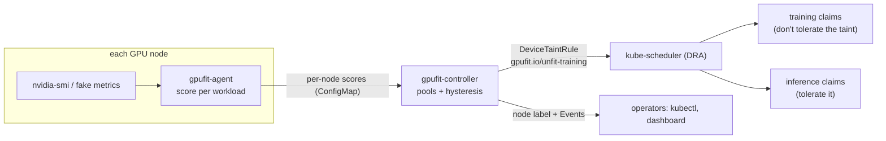

# GPUFit

[](https://github.com/praveen9161/gpufit/actions/workflows/ci.yml)

**Workload-aware GPU scheduling for Kubernetes.** GPUFit grades every GPU per workload
(training, fine-tuning, inference) and uses that grade for placement: a degraded GPU is kept
away from synchronous training, where it would slow every other GPU in the job, and keeps
serving inference, where it still performs almost like a healthy one.

**Measured on real GPUs:** with one of two NVIDIA A10Gs degraded, Kubernetes + GPUFit cut the
cost per useful GPU-hour from **$1.35 to $1.02 (-25%)** compared with Kubernetes alone.
([results](experiments/real-gpu/results/session-b-20261001-1128/README.md))

## Why

Clusters treat a GPU as healthy or broken. Real GPUs also end up *slow*: a lowered power
limit, a clock lock, heat. In synchronous distributed training every step waits for the
slowest GPU, so one slow GPU slows the whole job and every GPU in it is billed for the lost
time. Removing the GPU wastes it instead. Health tools like NVIDIA's
[NVSentinel](https://github.com/NVIDIA/NVSentinel) detect and remediate faults; GPUFit is the
placement layer for GPUs that are degraded but still useful.

The same degradation hurts workloads very differently. One A10G, power limit lowered from
300 W (session A2, 3 runs each):

| Power limit | Heavy matrix multiply (training-like) | Small CNN step | Memory copy (inference-like) |
|---|---|---|---|
| 250 W | 0.94 | 1.00 | 1.00 |
| 150 W | **0.68** | 0.94 | **1.00** |
| 100 W | 0.35 | 0.71 | 1.00 |

## How it works



- **Agent** (DaemonSet) turns GPU health into ratios (compute, memory, NVLink, network, thermal)
  and scores per workload. Training uses the *weakest* component, since one straggler sets the
  pace; inference and fine-tuning use a weighted mean. Collectors: `nvidia-smi` (real GPUs,
  including an "unexplained clock deficit" rule that catches clock locks nvidia-smi doesn't
  report) and a fake one for kind.
- **Controller** moves a node to the **inference pool** when a GPU is unfit for training, using
  [DRA device taints](https://kubernetes.io/docs/concepts/scheduling-eviction/dynamic-resource-allocation/),
  so it works with any DRA driver, including NVIDIA's. Asymmetric hysteresis (slow to recover)
  stops noisy GPUs from flapping. Running jobs are never evicted.
- **`kubectl gpufit why <pod>`** explains a Pending GPU pod. The scheduler says "cannot allocate
  all claims" whether the cluster is busy or the GPUs are unfit; this tells them apart, using
  the scheduler's own DRA CEL library:

  ```
  ✗ option gpu: needs 1, 0 usable
      tainted, not tolerated (1): ip-10-42-1-226/gpu-0 (gpufit.io/unfit-training)
      in use (1): ip-10-42-1-239/gpu-0 -> gpufit-lab/train-2gpu-0-c5q56
  note: node ip-10-42-1-226 is in the inference pool (gpu-0 training 50 < 80)
  ```
- **`gpufit-claim`** writes claims that ask for the best tier still free (score >= 95, then
  >= 90, then the minimum) with DRA prioritized lists, because DRA allocates first-fit and
  doesn't rank by score yet (measured: `experiments/ranking`).
- **[Cost calculator](docs/calculator/index.html)**: fleet-level savings from the measured
  slowdowns, with your own share of degraded GPUs.

## Results on real hardware (AWS, ~$3.30 total)

| Session | Hardware | Finding |
|---|---|---|
| [A](experiments/real-gpu/results/session-a-20260930-1055/README.md) | 1x Tesla T4 | power-limit and clock-lock changes are allowed on AWS VMs; nvidia-smi can't see clock locks |
| [A2](experiments/real-gpu/results/session-a2-20261001-0929/README.md) | 1x A10G | same degradation, very different cost per workload; scores must come from measured behavior, not settings |
| [B](experiments/real-gpu/results/session-b-20261001-1128/README.md) | 2x A10G, k3s 1.37, NVIDIA DRA driver | 2-GPU training with one GPU at 150 W runs at 0.84; with GPUFit, training gets the healthy GPU (1.00) and the degraded one serves inference at 0.98: **-25% cost per useful GPU-hour** |

With only two GPUs and no spare, GPUFit makes that training job slower (one GPU instead of two);
its gain there is efficiency. Fleet-wide savings depend on how often GPUs are degraded, which
isn't public: the calculator takes it as an input.

## Try it locally (kind, simulated GPUs, no GPU needed)

Needs Docker, kind, kubectl, helm, Go, jq (and GNU tar/make on macOS for the driver scripts).
The simulated GPUs come from [dra-example-driver](https://github.com/kubernetes-sigs/dra-example-driver)
with GPUFit's patch, which publishes the scores as `gpufit.io/<workload>Score` device attributes.

```bash
git clone https://github.com/kubernetes-sigs/dra-example-driver
cd dra-example-driver
git checkout -b gpufit 812a3f2 && git am ../driver-patch/*.patch
export DRIVER_IMAGE_TAG=v0.5.0-gpufit-2
./demo/scripts/build-driver-image.sh
./demo/clusters/kind/create-cluster.sh
helm upgrade --install dra-example-driver deployments/helm/dra-example-driver \
  -n dra-example-driver --create-namespace \
  --set image.tag=$DRIVER_IMAGE_TAG --set kubeletPlugin.gpufitScoresConfigMap=gpufit-scores
cd ..

./deploy/agent/build.sh
kubectl apply -f deploy/agent/fake-metrics.yaml -f deploy/agent/agent.yaml
./scripts/gpu-dash.sh            # live view; keep it open in a second terminal
```

Guided demos (each explains a step, runs it, and waits for Enter):

| Demo | Shows |
|---|---|
| `./experiments/in-cluster-agent/run.sh` | break a GPU's NVLink in the fake metrics; scores and placement follow within seconds |
| `./experiments/node-pools/run.sh` | a straggler moves the node to the inference pool: training Pending, inference still runs; repair brings it back |
| `./experiments/why/run.sh` | two Pending pods with the same scheduler message; `kubectl gpufit why` tells busy from unfit |
| `./experiments/claim-generator/run.sh` | training vs inference placement from one command per workload |

## Run it on real GPUs (AWS)

`deploy/aws` is Terraform for 1-2 GPU VMs that terminate themselves after 3 hours and are
locked to one account. `experiments/real-gpu/run.sh <session>` drives a whole session from your
machine: plan, apply (you confirm), measure, download results, destroy (you confirm), verify.
Session B installs k3s, NVIDIA's DRA driver and GPUFit on two VMs. **This costs money**; see
each session's README for what it cost.

## Repository

| Path | What |
|---|---|
| `agent/` | Go: scoring (`internal/fitness`), collectors (`internal/collect`), pools (`internal/pools`), Pending explanations (`internal/why`); binaries `gpufit-agent`, `gpufit-controller`, `gpufit-claim`, `kubectl-gpufit` |
| `deploy/` | kind manifests (`agent/`, `controller/`), real-cluster manifests (`real/`), Terraform (`aws/`) |
| `driver-patch/` | dra-example-driver patches (scores as device attributes) |
| `experiments/` | every experiment with a guided `run.sh`; `real-gpu/results/` holds raw data from the real-GPU sessions |
| `docs/design/` | design notes: collector, node pools, active probe, session B plan |
| `notes.md` | lab notebook: what was tried, what broke, what was measured |

## Limits and roadmap

- Tested on simulated GPUs and on T4 / A10G with *induced* degradation (power limit, clock lock),
  not yet on hardware that degraded on its own. NVLink and network health aren't measured yet.
- Scores from settings alone don't predict impact across GPU models (sessions A vs A2); the
  next step is an active probe (short per-workload runs on idle GPUs).
- Next: an observe-only mode with a savings report (run it for two weeks, see what it would have
  saved), Prometheus metrics, a DCGM collector, a Helm chart, rescuing jobs that are already
  running on a GPU that degrades.

## License

Apache-2.0. See [LICENSE](LICENSE).
