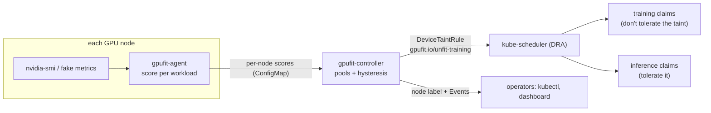

# GPUFit

[](https://github.com/praveen9161/gpufit/actions/workflows/ci.yml)

**Workload-aware GPU scheduling for Kubernetes.** GPUFit grades every GPU per workload
(training, fine-tuning, inference) and uses that grade for placement: a degraded GPU is kept
away from synchronous training, where it would slow every other GPU in the job, and keeps
serving inference, where it still performs almost like a healthy one.

**The story behind it:** [A slow GPU isn't a broken GPU](https://dev.to/praveen9161/a-slow-gpu-isnt-a-broken-gpu-grading-gpus-per-workload-in-kubernetes-measured-on-real-a10gs-4mij) (dev.to).

**Measured on real GPUs:**
- With one of two NVIDIA A10Gs degraded, Kubernetes + GPUFit cut the cost per useful GPU-hour
  from **$1.35 to $1.02 (-25%)** compared with Kubernetes alone
  ([session B](experiments/real-gpu/results/session-b-20261001-1128/README.md)).
- On 4 A10Gs, installed with the Helm chart, GPUFit moved a running 2-GPU training job off a GPU
  that degraded mid-run; it resumed from its checkpoint on healthy GPUs and finished sooner than
  leaving it as a straggler (987 s vs 1001 s; healthy 901 s)
  ([session C](experiments/real-gpu/results/session-c-20261002-1424/README.md)).

## Why

Clusters treat a GPU as healthy or broken. Real GPUs also end up *slow*: a lowered power
limit, a clock lock, heat. In synchronous distributed training every step waits for the
slowest GPU, so one slow GPU slows the whole job and every GPU in it is billed for the lost
time. Removing the GPU wastes it instead. Health tools like NVIDIA's
[NVSentinel](https://github.com/NVIDIA/NVSentinel) detect and remediate faults; GPUFit is the
placement layer for GPUs that are degraded but still useful.

The same degradation hurts workloads very differently. One A10G, power limit lowered from
300 W (session A2, 3 runs each):

| Power limit | Heavy matrix multiply (training-like) | Small CNN step | Memory copy (inference-like) |
|---|---|---|---|
| 250 W | 0.94 | 1.00 | 1.00 |
| 150 W | **0.68** | 0.94 | **1.00** |
| 100 W | 0.35 | 0.71 | 1.00 |

## Related work

Checked in October 2026. Others detect, predict or route around bad GPUs; as far as we found,
none grades GPUs by measured *performance per workload* and keeps the slow ones serving inference
through standard Kubernetes DRA, in the open.

| Work | What it does | Difference |
|---|---|---|
| [HeaRank](https://arxiv.org/html/2607.15115) (KDD 2026, production) | ranks GPUs by *failure risk*; high-risk nodes get lightweight or interruption-tolerant work | closest idea; predicts crashes per host, not slowdown per workload; no DRA |
| [NVIDIA DRA driver](https://github.com/kubernetes-sigs/dra-driver-nvidia-gpu/releases) | taints GPUs with fatal errors (XID) as DRA device taints | same mechanism, but healthy/unhealthy only |
| [FALCON](https://arxiv.org/abs/2410.12588) (Alibaba, HKUST), [Guard](https://arxiv.org/abs/2605.17879) | detect stragglers inside training jobs; rebalance, reroute, restart | inside one training framework; slow GPUs aren't reused for other work |
| [Crusoe AutoClusters](https://www.crusoe.ai/resources/blog/autoclusters-minimizing-hardware-failures-in-large-gpu-clusters), [NVSentinel](https://github.com/NVIDIA/NVSentinel) | detect faults, cordon, replace or remediate | remove-and-replace; GPUFit is the placement layer for GPUs that are slow but still useful |

What these studies also show, and what GPUFit doesn't cover yet: in FALCON's clusters
network slowdowns were 7.2x more common than GPU compute slowdowns, and many GPU problems are
crashes rather than slowdowns (Meta's Llama 3 run: 419 interruptions in 54 days on 16,384 GPUs).
See the roadmap.

## How it works



- **Agent** (DaemonSet) turns GPU health into ratios (compute, memory, NVLink, network, thermal)
  and scores per workload. Training uses the *weakest* component, since one straggler sets the
  pace; inference and fine-tuning use a weighted mean. Collectors: `nvidia-smi` (real GPUs,
  including an "unexplained clock deficit" rule that catches clock locks nvidia-smi doesn't
  report) and a fake one for kind.
- **Controller** moves a node to the **inference pool** when a GPU is unfit for training, using
  [DRA device taints](https://kubernetes.io/docs/concepts/scheduling-eviction/dynamic-resource-allocation/),
  so it works with any DRA driver, including NVIDIA's. Asymmetric hysteresis (slow to recover)
  stops noisy GPUs from flapping. **Observe mode** (the default) only reports what it would do;
  **enforce** applies it. With **rescue** on, training jobs that opted in
  (`gpufit.io/rescue: "true"`) are moved off a degraded GPU after a grace period and resume from
  their checkpoint; other running jobs are never touched.
- **`kubectl gpufit status`** shows scores and pools; **`kubectl gpufit report`** shows training
  time spent on degraded GPUs, the estimated waste and the rescues. Prometheus metrics on `:8080`.
- **`kubectl gpufit why <pod>`** explains a Pending GPU pod. The scheduler says "cannot allocate
  all claims" whether the cluster is busy or the GPUs are unfit; this tells them apart, using
  the scheduler's own DRA CEL library:

  ```
  ✗ option gpu: needs 1, 0 usable
      tainted, not tolerated (1): ip-10-42-1-226/gpu-0 (gpufit.io/unfit-training)
      in use (1): ip-10-42-1-239/gpu-0 -> gpufit-lab/train-2gpu-0-c5q56
  note: node ip-10-42-1-226 is in the inference pool (gpu-0 training 50 < 80)
  ```
- **`gpufit-claim`** writes claims that ask for the best tier still free (score >= 95, then
  >= 90, then the minimum) with DRA prioritized lists, because DRA allocates first-fit and
  doesn't rank by score yet (measured: `experiments/ranking`).
- **[Cost calculator](docs/calculator/index.html)**: fleet-level savings from the measured
  slowdowns, with your own share of degraded GPUs.

## Results on real hardware (AWS, ~$8.50 total)

| Session | Hardware | Finding |
|---|---|---|
| [A](experiments/real-gpu/results/session-a-20260930-1055/README.md) | 1x Tesla T4 | power-limit and clock-lock changes are allowed on AWS VMs; nvidia-smi can't see clock locks |
| [A2](experiments/real-gpu/results/session-a2-20261001-0929/README.md) | 1x A10G | same degradation, very different cost per workload; scores must come from measured behavior, not settings |
| [B](experiments/real-gpu/results/session-b-20261001-1128/README.md) | 2x A10G, k3s 1.37, NVIDIA DRA driver | 2-GPU training with one GPU at 150 W runs at 0.84; with GPUFit, training gets the healthy GPU (1.00) and the degraded one serves inference at 0.98: **-25% cost per useful GPU-hour** |
| [C](experiments/real-gpu/results/session-c-20261002-1424/README.md) | 4x A10G, Helm chart | observe -> enforce + rescue; a 2-GPU job degraded mid-run: straggler 1001 s, rescued 987 s (healthy 901 s). Rescue cost ~86 s fixed, the straggler 13% of remaining work: rescue pays off with more than ~10 min left (estimate; ~16 min with production timers). The report's waste estimate was 3.8x the measured waste |

These are small setups (2-4 GPUs, synthetic workloads, one kind of induced fault). A straggler
slows every GPU in its job, so the loss grows with job size; that hasn't been measured beyond
2-GPU jobs yet. Fleet-wide savings depend on how often GPUs are degraded; the calculator takes
it as an input.

## Install (Helm)

```bash
helm install gpufit charts/gpufit -n gpufit --create-namespace \
  --set pricePerGpuHour=2.50                # observe mode, NVIDIA's DRA driver (gpu.nvidia.com)
kubectl gpufit status -n gpufit
kubectl gpufit report -n gpufit             # what it would have saved
helm upgrade gpufit charts/gpufit -n gpufit --reuse-values --set mode=enforce
helm upgrade gpufit charts/gpufit -n gpufit --reuse-values --set rescue.enabled=true
```

Releases (tags `v*`) publish the image and chart to GHCR and `kubectl-gpufit` binaries to GitHub
Releases. Settings: [`charts/gpufit/values.yaml`](charts/gpufit/values.yaml).
`helm uninstall` removes every taint and label GPUFit applied.

## Try it locally (kind, simulated GPUs, no GPU needed)

Needs Docker, kind, kubectl, helm, Go, jq (and GNU tar/make on macOS for the driver scripts).
The simulated GPUs come from [dra-example-driver](https://github.com/kubernetes-sigs/dra-example-driver)
with GPUFit's patch, which publishes the scores as `gpufit.io/<workload>Score` device attributes.

```bash
git clone https://github.com/kubernetes-sigs/dra-example-driver
cd dra-example-driver
git checkout -b gpufit 812a3f2 && git am ../driver-patch/*.patch
export DRIVER_IMAGE_TAG=v0.5.0-gpufit-2
./demo/scripts/build-driver-image.sh
./demo/clusters/kind/create-cluster.sh
helm upgrade --install dra-example-driver deployments/helm/dra-example-driver \
  -n dra-example-driver --create-namespace \
  --set image.tag=$DRIVER_IMAGE_TAG --set kubeletPlugin.gpufitScoresConfigMap=gpufit-scores
cd ..

./deploy/agent/build.sh
kubectl apply -f deploy/agent/fake-metrics.yaml -f deploy/agent/agent.yaml
./scripts/gpu-dash.sh            # live view; keep it open in a second terminal
```

Guided demos (each explains a step, runs it, and waits for Enter):

| Demo | Shows |
|---|---|
| `./experiments/in-cluster-agent/run.sh` | break a GPU's NVLink in the fake metrics; scores and placement follow within seconds |
| `./experiments/node-pools/run.sh` | a straggler moves the node to the inference pool: training Pending, inference still runs; repair brings it back |
| `./experiments/why/run.sh` | two Pending pods with the same scheduler message; `kubectl gpufit why` tells busy from unfit |
| `./experiments/claim-generator/run.sh` | training vs inference placement from one command per workload |

## Run it on real GPUs (AWS)

`deploy/aws` is Terraform for 1-4 GPU VMs that terminate themselves after 3 hours and are
locked to one account. `experiments/real-gpu/run.sh <session>` drives a whole session from your
machine: plan, apply (you confirm), measure, download results, destroy (you confirm), verify.
Sessions B and C install k3s, NVIDIA's DRA driver and GPUFit on two and four VMs;
session C is rehearsed on kind first (`session-c/test/rehearse-kind.sh`). **This costs money**; see
each session's README for what it cost.

## Repository

| Path | What |
|---|---|
| `agent/` | Go: scoring (`internal/fitness`), collectors (`internal/collect`), pools (`internal/pools`), Pending explanations (`internal/why`); binaries `gpufit-agent`, `gpufit-controller`, `gpufit-claim`, `kubectl-gpufit` |
| `charts/gpufit/` | Helm chart (agent, controller, RBAC, metrics, uninstall cleanup) |
| `deploy/` | kind manifests (`agent/`, `controller/`), real-cluster manifests (`real/`), Terraform (`aws/`) |
| `driver-patch/` | dra-example-driver patches (scores as device attributes) |
| `experiments/` | every experiment with a guided `run.sh`; `real-gpu/results/` holds raw data from the real-GPU sessions |
| `docs/design/` | design notes: collector, node pools, active probe, session B plan, v0.1 tool |
| `notes.md` | lab notebook: what was tried, what broke, what was measured |

## Limits and roadmap

- Tested on simulated GPUs and on T4 / A10G with *induced* degradation (power limit, clock lock),
  not yet on hardware that degraded on its own, and on at most 4 GPUs.
- Scores are estimated from hardware signals; on a mild degradation the report's waste estimate
  was 3.8x the measured waste (sessions B, C). NVLink and network health aren't measured yet,
  although network slowdowns are the more common kind.
- Next (v0.2, "learned fitness"): learn each GPU's real speed per workload from the jobs' own step
  times (compared with the job's other GPUs), which also catches network slowdowns; a fleet
  simulator on public cluster traces and published failure rates; measurements with larger jobs
  (8-16 GPUs) to show how savings grow with job size; a DCGM collector.

## License

Apache-2.0. See [LICENSE](LICENSE).
